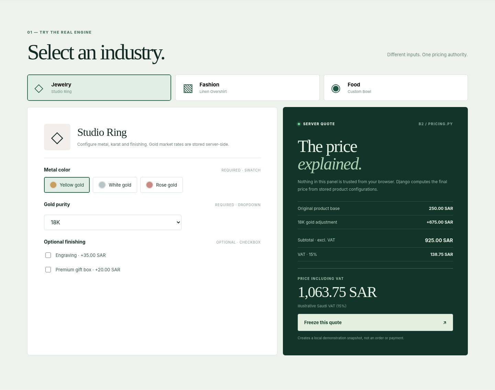

# MOHD Configurable Commerce Engine · Django Engineering Demo

**One reusable customization and pricing engine. Three industries. Real server-side calculations.**

A focused, runnable demonstration of engineering work from a larger private Django/Django Oscar commerce backend. The important part is genuine: the pricing function used here follows the original backend's `compute_price()` logic, backed by adapted ORM models and synthetic configuration data. The website submits selections to Django; **it does not calculate prices in JavaScript**.

> **Scope:** Standalone local demo—not the original full Django Oscar store, no actual orders or payments, no production data, and no external credentials. See [`docs/SOURCE_MAP.md`](docs/SOURCE_MAP.md) for an exact breakdown of reused vs adapted vs demonstration-only code.



## Start locally (Windows / macOS / Linux)

Prerequisite: **Python 3.12+** and internet access once to install Django. SQLite ships with Python; no PostgreSQL, Oscar, API keys or account required.

```bash
# Open a terminal in this repository folder
python -m venv .venv

# macOS / Linux
source .venv/bin/activate

# Windows PowerShell instead
# .venv\Scripts\Activate.ps1

python -m pip install -r requirements.txt
python manage.py migrate --run-syncdb
python manage.py seed_demo
python manage.py runserver
```

Then open **http://127.0.0.1:8000/**.

On Windows, if `python` is unavailable, try `py -3.12` for the initial venv command. You do not need to set up an external database.

If your terminal uses a restricted PowerShell execution policy, you can skip activation and run commands with `.venv\Scripts\python.exe` directly.

## Try the three scenarios

| Scenario | Test | Actual backend behavior |
|---|---|---|
| **Jewelry** | Switch 18K ↔ 21K, add engraving | Only the matching market rule applies; option deltas and VAT are itemized. Gold values are local sample rates, **not live quotes**. |
| **Fashion** | Select size/color and turn on embroidery | Merchant configured choice adjustment (15 SAR) + conditional rule (5% of base price) are computed server-side. |
| **Food** | Increase/decrease included avocado, add cheese, choose extra chili | A default-included stepper is not double billed; optional deductions below the default and conditional level rules apply. |

Click **“Freeze this quote”** to save a demonstration-only JSON snapshot to the local SQLite database. The response freezes choice labels, quantities, adjustment rows and final amounts. It does **not** place a purchase order, charge money or contact a customer.

## Automated testing — 19 Django tests

All **19 tests** are defined in [`apps/demo/tests.py`](apps/demo/tests.py) under `ConfigurableCommerceTests`. Django discovers methods prefixed with `test_` and creates an isolated test database; the test class seeds synthetic jewelry, fashion, and food examples.

Run the same checks locally as GitHub Actions:

```bash
python manage.py check
python manage.py test apps.demo -v 2
```

| # | Automated test | What it verifies |
|---|---|---|
| 1 | `test_homepage_and_three_examples` | Homepage responds and all three demo product categories are listed. |
| 2 | `test_ring_uses_real_market_rule_and_vat` | Jewelry pricing applies the market rule and calculates 15% VAT. |
| 3 | `test_gold_21k_applies_alternative_rule_not_both` | Switching to 21K applies only the matching gold rule. |
| 4 | `test_required_option_cannot_be_missing` | Missing required selections return a validation error. |
| 5 | `test_invalid_or_foreign_product_choice_rejected` | Unknown choices and choices belonging to another product are rejected. |
| 6 | `test_max_select_is_server_enforced` | A group's maximum selections cannot be bypassed through the API. |
| 7 | `test_food_default_included_stepper_not_double_charged` | Default-included food quantities are not charged a second time. |
| 8 | `test_stepper_zero_quantity_returns_opt_in_credit` | Removing an included ingredient yields the configured opt-in credit. |
| 9 | `test_stepper_quantity_limit` | Quantities above a configured stepper maximum are rejected. |
| 10 | `test_food_level_and_quantity_rules` | Quantity, spice level, and ingredient-choice rules combine correctly. |
| 11 | `test_wrong_level_id_rejected` | An invalid level ID is rejected. |
| 12 | `test_fashion_percent_and_fixed_choice` | Fixed choice adjustments and percentage rules work together for fashion. |
| 13 | `test_unavailable_market_rate_fails_closed` | Missing market data prevents a price quote. |
| 14 | `test_stale_external_market_rate_fails_closed` | Expired external market data prevents a price quote. |
| 15 | `test_client_supplied_price_is_ignored` | Client-submitted price, tax, and total values cannot override server pricing. |
| 16 | `test_malformed_json_rejected` | Malformed JSON requests return HTTP 400. |
| 17 | `test_negative_final_price_rejected` | Discount configurations that produce negative totals are rejected. |
| 18 | `test_snapshot_frozen_after_product_and_market_change` | Saved sample quotes remain unchanged after base prices and market rates change. |
| 19 | `test_post_csrf_protected_in_real_browser` | A browser POST without a valid CSRF token is rejected. |

**Verification:** The test suite previously passed locally on Windows with Python 3.12 and Django 6.1.3 (19/19). On **7 November 2026**, GitHub Actions also completed the Django checks, all 19 tests, and artifact packaging successfully. [View the successful run](https://github.com/MOHD97v/mohd-configurable-commerce-engine/actions/runs/42375493331).

## GitHub Actions — CI and demo artifact delivery

The repository includes [`.github/workflows/ci.yml`](.github/workflows/ci.yml), which runs automatically when changes are pushed to `main` or a pull request is opened, and can also be started manually using **Actions → Django CI and Demo Artifact → Run workflow**.

The workflow:

1. Checks out the repository and configures **Python 3.12** with pip caching.
2. Installs the dependencies from `requirements.txt`.
3. Runs `python manage.py check` and `python manage.py test apps.demo -v 2`.
4. **Only if the checks pass**, packages the runnable source, documentation, demo assets, and setup files into `commerce-pricing-demo.zip`.
5. Uploads the ZIP as a GitHub Actions artifact named `commerce-pricing-demo` with **3-day retention** (it expires automatically to limit storage use).

To inspect or download an artifact, open the [Actions runs](https://github.com/MOHD97v/mohd-configurable-commerce-engine/actions), choose a successful **Django CI and Demo Artifact** run, and find **Artifacts**. GitHub sign-in may be required to download artifacts. For an independent reproduction, a reviewer can fork the repository, enable Actions if prompted, then run the workflow in their own fork.

**Scope:** This is automated continuous integration (CI) plus delivery of a **downloadable demo ZIP**; it does **not** deploy a website or production service, and it does not touch the private Django/Oscar platform or YAGARZ.

## Architecture

```text
Synthetic Product Types and Product Configurations (SQLite)
                           |
                           v
        GET /api/products/{slug}/  -> option groups
                           |
                    Browser selection
                           |
                           v
             POST /api/quote/  (CSRF)
                           |
                Validate input/IDs
                           |
                           v
        apps/options/pricing.py::compute_price()
       (required choices, levels, stepper defaults,
          market-based/fixed/percent rules)
                           |
                           v
                Authoritative quote + VAT
                           |
                Optional user action
                           |
                           v
             POST /api/snapshots/
                           |
                           v
          Frozen DEMO record in SQLite
```

Core files:

- `apps/options/pricing.py` — pricing authority and business-rule evaluator.
- `apps/options/models.py` — compact version of the real reusable configuration model.
- `apps/catalogue/models.py` — minimal Oscar-compatible product and product-type stubs.
- `apps/demo/views.py` — public demo routes and saved snapshot flow.
- `apps/demo/management/commands/seed_demo.py` — three synthetic demonstrations.
- `apps/demo/tests.py` — actual Django tests (requires installing dependencies).

## The engineering point

A single configurable product platform can interpret different product selection mechanisms and pricing behaviors without creating separate code paths for every merchant industry. Configuration lives in the database; the backend resolves actual rules and validates the final amount. This is the same design principle used in the original private commerce platform.

## Local demo and security boundaries

- The example is intended to run on **your computer at 127.0.0.1**.
- `DEBUG=True` and the documented development key are for local development **only**. They are intentionally not production secrets. Do not deploy to the public internet without a new configuration and security review.
- No payment gateway, email account, OAuth client, customer account, production token, provider key, or personal records are included.
- POST routes use Django's default CSRF protection. Saved snapshots have no customer identity fields.
- The `demo.sqlite3` file is local and excluded via `.gitignore`.
- This small demo intentionally uses `migrate --run-syncdb` rather than importing the private store's migrations or full Oscar dependencies. The original backend has its own migrations. Do not treat this as a deployment architecture.
- All seeded products, prices and market quotes are **examples**, not Yagarz/ShipMatrix production values.

## Repository scope

This public repository is intentionally isolated from the original private commerce backend. Leave `demo.sqlite3`, `.venv` and `.env` out of commits (already covered by `.gitignore`).

Screenshots are UI previews; executable behavior requires running the Django server as described above.
